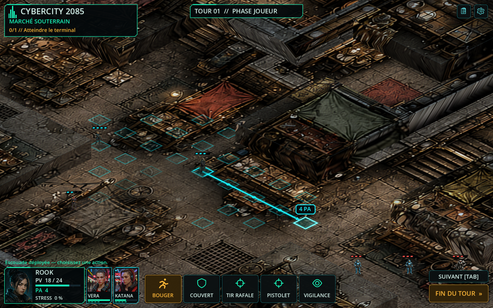

# Tactical reference presentation, deployment and music continuity

## Deployment fix

Encounter placement now selects the largest connected region of surveyed floor,
with proximity to the requested deployment as a tie-breaker. All agents, enemies
and the objective get distinct cells in that region. Temporary unit occupancy is
excluded from this topology calculation. Collision cells and wall surveys are
unchanged.

The underground market and its duplicate previously deployed everyone into an
isolated 68-cell perimeter instead of the main 421-cell interior. The regression
driver checks all 122 maps for unique spawns and routes to the objective.

## Reference presentation

The default visual interface draws a cyan route with luminous waypoints, an
arrow ending at the destination diamond, and a beveled badge showing the real
movement AP cost. Grid cells and movement costs are unchanged. The active unit
uses a matching ground diamond. Unreachable or cleared paths show no badge.

Health bars are segmented and beveled, cyan for allies and red for enemies. They
stay six screen pixels thick, eight pixels above visible sprite pixels, with
transparent portrait margins removed. Animated atlas bounds are measured once
and cached as small normalized rectangles. Segment fills use the actual HP
fraction, clamped to valid bounds; segment count follows max HP (3–10 segments).



## Music transport

`MusicTransitionMixin` pauses music before `show_view` loads another interface
and resumes only when the destination is ready. Nested view changes are handled.
Aliases using the same physical audio file reuse the same player and timestamp;
different tracks retain independent bookmarks for later visits.

The Godot handoff carries `audio.start_position`. Arcade stays paused while the
child owns playback. Mission results include a track/time bookmark and capture
timestamp, allowing the returning interface to account for child playback before
resuming the matching file. Disabled audio remains disabled. The bridge passes
bookmarks for MP3 and WAV soundtracks without resetting an already playing track.

## Validation

37 focused tests pass, including a real Linux/X11 Arcade → Godot → management
round trip, music alias/bookmark tests, and Godot runtime checks over all 122 maps.
The capture driver also executes a rightward move on the underground market,
checks the AP deduction and waits for the rendered agent to reach the target.
The existing FX lifetime test now waits for the real remaining TTL, including
smoke, rather than assuming all explosion effects expire after 2.1 seconds.

```sh
python -m pytest -q tests/test_music_continuity.py tests/test_godot_combat_bridge.py tests/test_godot_launch_routing.py tests/test_godot_file_exchange.py tests/test_godot_move_highlights.py tests/test_ui_motion_audio.py tests/test_tactical_reference_runtime.py
```

To capture the reference scenario with a real display:

```sh
godot --path godot/combat_missions_ui --rendering-method gl_compatibility --audio-driver Dummy --script tests/capture_reference.gd
```

The driver creates its own isolated handoff and screenshot under `work/`.
