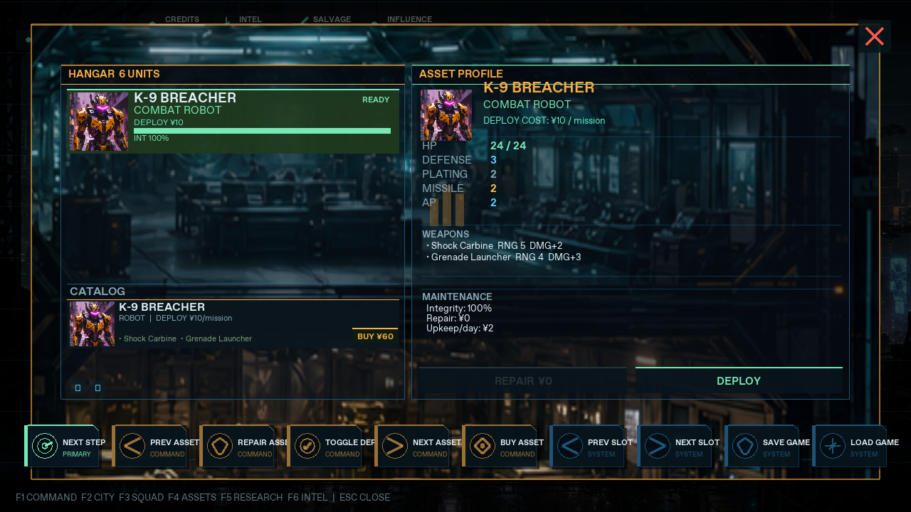
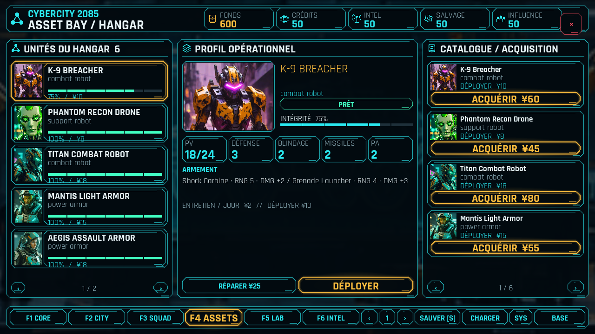
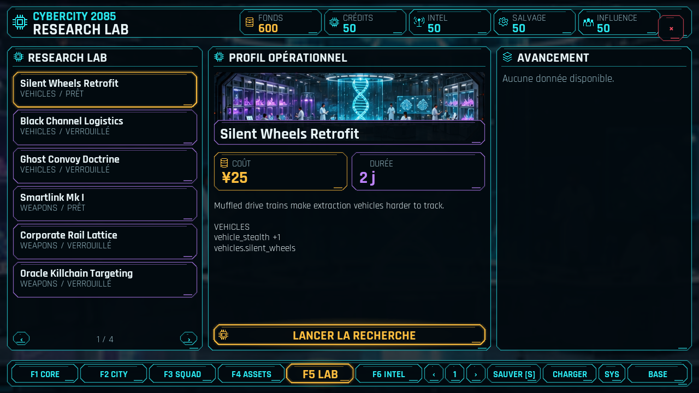
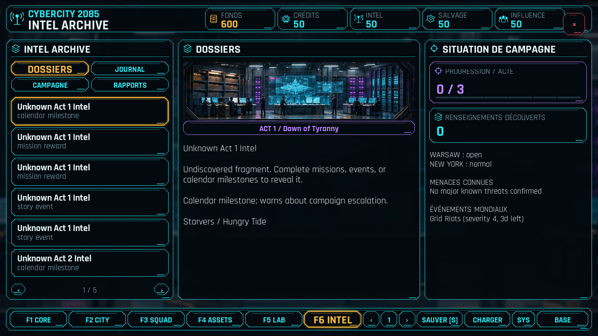

# UI Visual Unification Pass

Passe du 17 novembre 2026. Les vues de gestion restantes utilisent désormais les mêmes primitives réelles que Squad Command 2.0 : panneaux biseautés, typographie Rajdhani, accents cyan/orange, portraits cadrés sans déformation, jauges segmentées, états de sélection, survol et indisponibilité.

## Architecture et périmètre

- `game/ui/theme/visual.py` centralise la palette et les tokens visuels. `squad_style.py` reste un import de compatibilité pour les interfaces déjà modernisées.
- `game/ui/components/visual_kit.py` contient les primitives extraites du renderer Squad Command, avec cache des textures, glyphes et meshes. Squad Command, Headquarters, Character Sheet, Mission Briefing et Main Menu continuent à les réutiliser par leur héritage existant.
- `document_kit.py` ajoute les lecteurs et listes paginés : tous les éléments restent accessibles, y compris les longs rapports, noms, identifiants et chemins. Le retour à la ligne tient compte de la taille de texte configurée.
- `layouts/department_deck.py` fournit la géométrie responsive commune. Les renderers spécialisés sont répartis dans `components/departments/` et `components/utilities/`. Les anciens blocs de dessin devenus inutiles ont été retirés des vues utilitaires.
- Les actions appellent les contrôleurs existants. Les valeurs, coûts, personnages, équipements, projets, informations narratives et illustrations restent dynamiques. Aucun relevé géométrique, texture de carte, calcul de combat ou règle de campagne n’a été modifié.

### Départements

| Vue | Présentation et interactions |
| --- | --- |
| Asset Bay / Hangar | Liste paginée avec portraits et intégrité ; grand profil, armure, missiles, PA et armement ; pilotes ; réparation et déploiement ; catalogue illustré et acquisition. |
| Command Core | Prévisions financières, budgets, crises et réponses, trois directives hebdomadaires, avance du jour. |
| City Grid | District, stabilité, agitation, pression médiatique, infrastructures et factions. |
| Research Lab | Tous les projets, prérequis, coût, durée, effets, état verrouillé/disponible/en cours/terminé et progression. |
| Intel Archive | Dossiers, journal, cinq fils de campagne, derniers rapports et conséquences ; détails complets séparés du résumé de situation. |

Les cinq départements partagent le HUD de ressources, les raccourcis F1–F6, les emplacements de sauvegarde, les actions sauvegarder/charger, les paramètres et le retour à la base. Les boutons invisibles de l’ancien bandeau ne capturent plus les clics derrière la nouvelle interface.

### Utilitaires et sous-pages

Le même kit présente le recrutement avec dossier complet, les paramètres système, la création de campagne, les promotions, le débriefing, l’épilogue de campagne, les quatre états des missions narratives et l’écran de liaison/récupération Godot. Les raccourcis et les chemins de lancement, retour et fallback Arcade restent ceux du jeu.

Les vues avec personnage ou campagne reprennent leur langue configurée ; les noms et textes issus des données restent affichés tels qu’ils sont fournis par le jeu. La création de campagne et le menu global gardent leur langue de démarrage existante.

## Corrections fonctionnelles nécessaires

Le nouveau catalogue affiche plusieurs modèles à la fois. Son action utilise donc l’identifiant réel du modèle ; l’ancienne action relative aux deux éléments visibles reste compatible. La transaction d’acquisition existante est réutilisée.

La validation du rechargement a révélé que les types d’assets hors `combat_robot` et `power_armor` perdaient leur argument `asset_type` à la désérialisation. Cet argument est maintenant transmis explicitement, sans modifier les champs ni le format de sauvegarde. Un test sauvegarde et recharge l’intégralité du catalogue et compare toutes ses données.

## Validation

Les campagnes utilisées sont des fixtures isolées. Les sauvegardes de test utilisent un répertoire temporaire ; les actions de paramètres qui écrivent ou changent l’écran sont vérifiées via leurs contrôleurs sans modifier les préférences de l’utilisateur.

- **163 tests ciblés réussis**, avec 5 sous-tests supplémentaires. Les anciens tests utilisant un faux module Arcade sont exécutés séparément, car ils remplacent globalement ce module. Leur double de rendu cible maintenant le kit partagé ; les assertions tiennent compte des nouvelles listes et des boutons désactivés. Les deux tests natifs ignorés dans l’exécution sans DISPLAY sont couverts par les vérifications natives ci-dessous.
- **Deux parcours natifs dédiés** : achats, réparation, déploiement, pilotes, catalogue décalé, toutes les pages de recherche, budgets, directives, réponses aux événements, archives, sauvegarde/rechargement, raccourcis, paramètres, saisie de campagne, recrutement et machine d’états narrative.
- **Quatre régressions natives** : Headquarters, Main Menu, Squad Command/Character Sheet et Mission Briefing. Elles vérifient notamment les interactions, sauvegardes, langues, musique de menu, fallback graphique, navigation et inspection de la véritable carte tactique.
- Captures réelles à **1280×720, 1920×1080 et 2560×1440**, avec variantes de texte agrandi, sélection et survol désactivé. Vérification visuelle des cadrages, textes et panneaux ; correction d’illustrations recouvertes, de libellés trop longs et de l’ancienne page de paramètres qui débordait.
- Le parcours département compare avant/après chaque rendu les personnages, assets, fonds, budgets, ressources et campagne sérialisée pour vérifier l’absence de mutation. Les listes de clic restent dans la fenêtre.
- Mesure indicative sur le rendu logiciel de cette machine : environ **18–20 ms** par frame chaude pour un département. Les textes et illustrations sont mis en cache ; cette mesure n’est pas une garantie de performances sur toutes les machines.

### Reproduire les captures et interactions

Avec un serveur d’affichage disponible :

```bash
DISPLAY=:103 ALSOFT_DRIVERS=null python -m tools.check_unified_ui_visual
DISPLAY=:103 ALSOFT_DRIVERS=null python -m tools.check_unified_utilities_visual
DISPLAY=:103 ALSOFT_DRIVERS=null python -m tools.check_squad_command_visual
DISPLAY=:103 ALSOFT_DRIVERS=null python -m tools.check_headquarters_visual
DISPLAY=:103 ALSOFT_DRIVERS=null python -m tools.check_title_menu_visual
DISPLAY=:103 ALSOFT_DRIVERS=null python -m tools.check_mission_briefing_visual
```

Les commandes produisent les PNG natifs et un résumé des assertions. Les captures du dépôt sont encodées en **WebP sans perte**, à leur résolution originale. Le manifeste conserve leurs dimensions et empreintes des pixels RGBA ; aucune interface n’a été recréée à partir d’une image.

## Captures

[Galerie complète, trois résolutions et états complémentaires](images/ui-unification/README.md).

### Hangar avant / après





### Recherche et renseignements





## Reproduire les captures

Avec un environnement Arcade/OpenGL disponible :

```bash
python -m tools.check_unified_ui_visual
python -m tools.check_unified_utilities_visual
python -m tools.check_squad_command_visual
python -m tools.check_headquarters_visual
python -m tools.check_title_menu_visual
python -m tools.check_mission_briefing_visual
```

Les deux nouveaux outils produisent les PNG originaux dans `work/unified-ui/`. Les [65 captures sans perte et leurs rapports natifs](images/ui-unification/README.md) sont inclus dans le dépôt pour consultation sans relancer le jeu.
